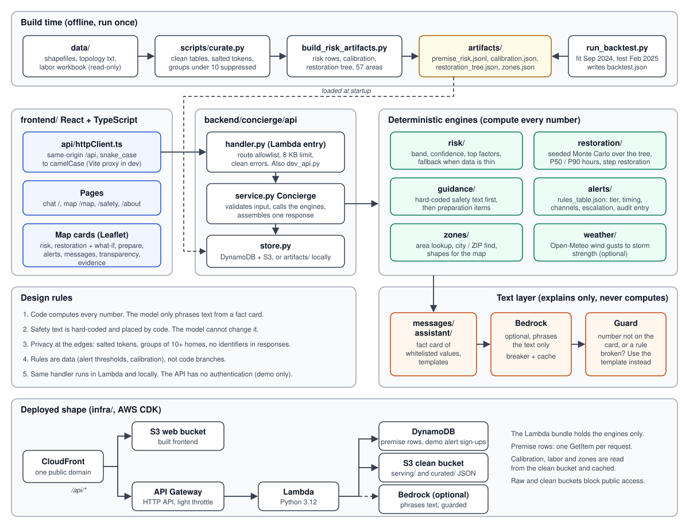

# Architecture

The system has two halves. An offline build turns the raw challenge data into artifacts. One request handler then serves
those artifacts to a React app. Code computes every number; the language model only phrases text.

## Build time

- `backend/concierge/curate/` (run by `scripts/curate.py`) cleans the raw shapefiles, topology and labor workbook into
  tables under `artifacts/curated/`. Premise ids become salted `p_...` tokens, and any group under 10 premises is suppressed.
- `scripts/build_risk_artifacts.py` writes `artifacts/risk/`: one risk row per premise, `calibration.json`,
  `restoration_tree.json` (the devices between substation and customer) and `zones.json` (the map areas).
- `scripts/run_backtest.py` fits on Sep 2024, tests on Feb 2025, and writes `artifacts/backtest/backtest.json`,
  which `GET /evidence` serves.
- `pipeline/` is a separate GeoPandas pipeline with its own venv and tests. It writes to `curated/`, and the risk engine
  does not read it yet. Its token format is incompatible with the risk engine's.

## Run time

`api/handler.py` is the Lambda entry point. `scripts/dev_api.py` serves the same function on `127.0.0.1:8787`, so local
and deployed behavior match. The handler checks the route against an allowlist, limits the body to 8 KB and turns
errors into clean JSON. It then calls `Concierge.handle(route, body)` in `api/service.py`, which uses these modules:

| Module | Job |
| --- | --- |
| `risk/` | Token and severity in; band, confidence with its reason, and top factors out. Returns a fallback when data is thin. |
| `restoration/` | Seeded Monte Carlo over the restoration tree, with crews as one pool working a priority list. Gives P50 and P90 hours and the steps in which service returns. |
| `guidance/` | Hard-coded safety text first, then preparation items by risk and duration, then declared-need items appended verbatim. |
| `alerts/` | `rules_table.json` turns band, duration and declared needs into a tier, timing, channels and escalation. Every decision writes an audit entry. |
| `zones/` | Loads the map areas, resolves a typed city or ZIP to an area, and shapes engine output for the map. |
| `weather/` | Open-Meteo wind gusts mapped to a storm strength. Optional, and never passed to the model. |
| `messages/`, `assistant/` | Eight kinds of text, including the four stage messages. Templates by default; Bedrock phrases them when configured. |

Two kinds of route exist. Token routes (`/risk`, `/restoration`, `/summary` and others) take an opaque premise token.
Map routes (`/zones`, `/zones/find`, `/zones/assess`) take a `zone_id`, and the server looks up the area's representative
token. No token reaches the browser.

`api/store.py` reads premise rows from DynamoDB (one GetItem per request) and the JSON files from S3 in the cloud. Locally
it reads the files in `artifacts/` through the `*_FILE` environment variables.

## The text layer

The assistant builds a fact card of whitelisted values and gives the model a projection with no digits. A guard then
checks the draft for rule breaks and for any number not on the card. A rejected draft is replaced by the template. A
circuit breaker and a response cache wrap the Bedrock call. Safety text lives in `assistant/safety.py` and is placed by
code, so the model cannot change or drop it.

## Frontend

`frontend/src` has four pages: chat (`/`), outage map (`/map`), `/safety` and `/about`. `api/httpClient.ts` is the only
network layer; it converts snake_case to camelCase against the types in `api/types.ts`. Vite proxies `/api` to the local
API in development. The map page is a set of cards around one `ZonePanel`, and `useZoneAssessment` calls
`/zones/assess` again whenever severity, crews, access, damage or declared needs change. The chat page's storm summary
still comes from `api/mockClient.ts`.

## Deployed shape

The CDK stack in `infra/` puts CloudFront in front of an S3 web bucket and, for `/api/*`, an API Gateway HTTP API that
invokes a Python 3.12 Lambda. The Lambda reads DynamoDB (premise rows and the demo alerts table) and the clean bucket's
`serving/` and `curated/` files, and optionally calls Bedrock. The API has no authentication and only a light throttle,
so it is a demo deployment.

## Design choices

- One handler, many engines, so what runs locally is what ships.
- Rules are data (alert thresholds, calibration), not code branches.
- Privacy is enforced at the edges: salted tokens, groups of at least 10 homes, whitelisted columns, and no identifiers in
  responses.
- Honest limits are part of the product: the evidence card shows where the model did not beat a baseline.
